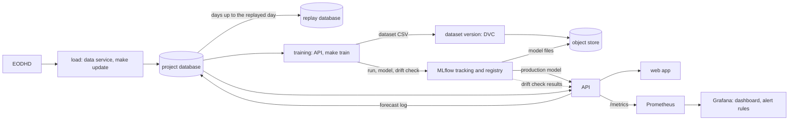
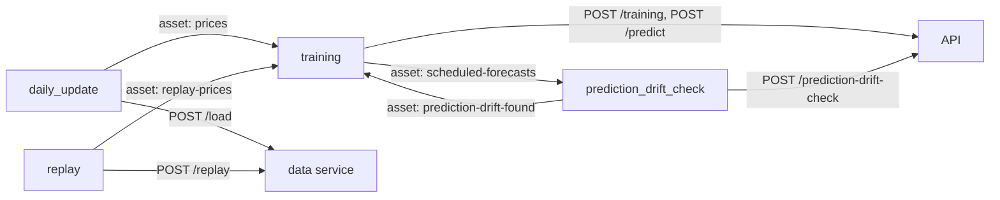

# Architecture

How the forecasting service is built and why. It cites the requirements it implements by
id (REQ-…); they are in [docs/requirements.md]. Decisions are in [docs/plan.md], the
options weighed for single decisions in [docs/decisions/], and what each Python package
does in [docs/dependencies.md]. The [README] is the front door; [DEPLOYMENT.md] covers
installing and running the system and [SECURITY.md] what it holds and who can reach it.

[DEPLOYMENT.md]: DEPLOYMENT.md
[docs/decisions/]: docs/decisions/
[docs/dependencies.md]: docs/dependencies.md
[docs/plan.md]: docs/plan.md
[docs/requirements.md]: docs/requirements.md
[README]: README.md
[SECURITY.md]: SECURITY.md

## Terms

The documents use these words in this sense.

-   **Member**: whoever runs a copy of the system. Every team member runs their own
    copy.
-   **Security**: a stock the system loads, trains a model for and forecasts. Market
    indices are loaded too, as reference series, but never forecast.
-   **Quote**: the prices of one security for one trading day as the data source
    delivers them: open, high, low, close and volume.
-   **Final close** and **provisional close**: while an exchange's session runs, the
    latest price stands in for the close; that is a provisional close, and a later fetch
    replaces it. A close is final once it was fetched a set time after the exchange's
    close.
-   **Final delay**: that set time, in whole minutes (`final_delay_minutes`).
-   **Load limit**: the longest a load may run (`load_limit_minutes`). A scheduled daily
    update that has no load by then counts as missed.
-   **Replay**: playing stored history back one trading day at a time into a database of
    its own, as if each day were arriving live.
-   **Asset**: Airflow's name for a marker that a pipeline announces when its task
    succeeds and that other pipelines wait for.
-   **Scheduled forecast**: a forecast that the training pipeline asks for after
    training and marks as scheduled. Only these take part in the prediction drift check.
-   **Persistence baseline**: the forecast "tomorrow's close equals today's close", that
    is, a change of 0. The **mean-change baseline** forecasts the mean change of the
    training days instead. Every model is scored against both.
-   **Production model**: the model, registered in MLflow under the alias `production`,
    that the API uses for forecasts.
-   **Dataset version**: the identifier DVC gives to the exact prices a training read.
-   **Project image**: the Docker image that holds the project's code and its locked
    packages. The commands, the API and the data service run from it.

## Stack

The system is a set of services that Docker Compose runs, each in its own container, on
the member's own machine, with no cloud service (REQ-AUT-003, REQ-CON-002). Libraries
run inside those services. EODHD, the market-data provider, is the one outside source.
The package `forecasting` runs from the project image, the web app from an image of its
own, and the pipelines in Airflow's image. In "When it is down", "down" means that the
component does not answer.

-   **PostgreSQL (`db`)**
    -   What it does: Holds the project's prices, splits, dividends, load times and
        forecasts. The same server holds the private databases of MLflow and Airflow
    -   Why it was chosen: The data is a table with fixed columns. A primary key rules
        out duplicate days. One server serves all three databases ([database decision])
    -   Depends on: Nothing
    -   When it is down: Everything that reads or writes data fails: loads, training,
        forecasts, history and the pipelines. The API still answers `/health` and
        reports its request numbers, but leaves out the freshness and drift numbers
-   **EODHD (outside)**
    -   What it does: Delivers daily prices, splits and dividends, read with the
        member's own free key
    -   Why it was chosen: One source for stocks and market indices on exchanges
        worldwide
    -   Depends on: The internet; the free tier's daily call allowance
    -   When it is down: A load fails and stores nothing. Everything else works on the
        stored days. The alert "Daily update missed" fires once a scheduled load passes
        its load limit
-   **exchange_calendars (library)**
    -   What it does: Answers four questions about an exchange: is a day a trading day,
        which trading day comes next, which trading days lie between two dates, and when
        does a session close
    -   Why it was chosen: These are the four questions the system asks of a calendar
        ([trading calendar decision])
    -   Depends on: Nothing at run time
    -   When it is down: Not applicable: it is part of the image
-   **scikit-learn (library)**
    -   What it does: Fits the model: a `StandardScaler` followed by a
        `LinearRegression`
    -   Why it was chosen: Fast to train, nothing to tune, and each coefficient can be
        explained ([regressor decision])
    -   Depends on: Nothing
    -   When it is down: Not applicable: it is part of the image
-   **Evidently (library)**
    -   What it does: Runs the drift test and writes its report
    -   Why it was chosen: Prescribed for drift reports (REQ-CON-001)
    -   Depends on: Nothing
    -   When it is down: Not applicable: it is part of the image
-   **API (FastAPI under Uvicorn, `api`)**
    -   What it does: Serves forecasts, training, the prediction drift check, the
        securities list, price history, model results and `/metrics`. Its documentation
        pages `/docs` and `/redoc` load scripts, styles, icons and fonts from
        `cdn.jsdelivr.net`, `fastapi.tiangolo.com` and, for `/redoc`,
        `fonts.googleapis.com` and `fonts.gstatic.com`, so only these two pages need the
        internet
    -   Why it was chosen: One application over the same package functions the commands
        call. The web app and the training and prediction drift check pipelines reach
        the system only through it
    -   Depends on: PostgreSQL, MLflow
    -   When it is down: The web app shows a short error and no forecasts. Pipeline
        calls for training, forecasts and checks fail, and each run names every security
        that failed. Prometheus collects nothing, so the dashboard shows no new numbers
-   **Data service (`data`)**
    -   What it does: Runs the load and the replay for the pipelines; no port is
        published on the host
    -   Why it was chosen: Airflow's image holds none of the project's packages and
        never receives the EODHD key, so the pipelines call this service
    -   Depends on: PostgreSQL, EODHD
    -   When it is down: The daily update and replay pipelines fail. `make update` and
        `make replay` run in their own container and still work while the services they
        wait for are healthy
-   **MLflow (`mlflow`)**
    -   What it does: Records training and drift check runs and holds the model
        registry. The alias `production` marks the model the API uses for forecasts
    -   Why it was chosen: Prescribed for tracking and the registry (REQ-CON-001). It
        keeps its records in a database of its own on the PostgreSQL server
    -   Depends on: PostgreSQL, object store
    -   When it is down: Training, forecasts, model results and the prediction drift
        check fail with the reason, and the dashboard leaves the drift numbers out. The
        pipelines' loads and replays, price history and the securities list keep
        working. `make update` and `make replay` do not need MLflow themselves, but they
        do not start until it is healthy, because all project commands share one Compose
        service that waits for it
-   **Object store (SeaweedFS, `object-store`)**
    -   What it does: An S3-compatible store for MLflow's model files (bucket `mlflow`)
        and the dataset copies of DVC (bucket `datasets`); no port is published on the
        host
    -   Why it was chosen: Files do not belong in PostgreSQL, and both MLflow and DVC
        speak S3. SeaweedFS has the Apache-2.0 licence, is maintained and is the default
        object store of Kubeflow Pipelines. It runs on the member's machine, so price
        data never leaves it
    -   Depends on: Nothing
    -   When it is down: Training fails: for a security with a recorded training,
        already when its feature drift check stores its report; for a first training, at
        the dataset version step. Loading a model for a forecast fails too. Model
        results, price history and the drift numbers keep working
-   **DVC (library)**
    -   What it does: Gives each training dataset a version id and keeps a copy of it,
        without Git
    -   Why it was chosen: Records a dataset under a fingerprint of its content
        (REQ-CON-001, REQ-DAT-006)
    -   Depends on: Object store
    -   When it is down: Training fails, because the dataset version is written before
        it trains
-   **Airflow (`airflow-apiserver`, `airflow-scheduler`, `airflow-dag-processor`)**
    -   What it does: Runs the four pipelines on their schedule or when another pipeline
        announces new data, and shows each run's reason on its page
    -   Why it was chosen: Prescribed for scheduled pipelines (REQ-CON-001); asset
        announcements chain the pipelines
    -   Depends on: PostgreSQL (a database of its own), the data service, the API
    -   When it is down: No scheduled load, replay, training or drift check runs. The
        commands, the API and the web app work on
-   **Prometheus (`prometheus`)**
    -   What it does: Collects the API's numbers and computes the error rate
    -   Why it was chosen: Prescribed for monitoring (REQ-CON-001)
    -   Depends on: The API
    -   When it is down: The dashboard shows no new numbers, and Grafana's alert rules
        report an error because Prometheus cannot be asked
-   **Grafana (`grafana`)**
    -   What it does: Shows the dashboard "API" and raises the alert rules; both come
        from files in `grafana/`. At start it may fetch plugin signing keys from
        `grafana.com`
    -   Why it was chosen: Prescribed for dashboards and alerts (REQ-CON-001)
    -   Depends on: Prometheus
    -   When it is down: No dashboard and no alerts; nothing else is affected
-   **Web app (Streamlit, `webapp`)**
    -   What it does: The page for a security's closes, forecast and model results
    -   Why it was chosen: Reads only through the API, so the API's rules (refusals, the
        replay switch, final and provisional closes) apply in one place
    -   Depends on: The API
    -   When it is down: Nothing else is affected
-   **Docker Compose and the project image (`Dockerfile`, uv)**
    -   What it does: Start every service and give the code its locked packages
    -   Why it was chosen: One command starts the system, and one lock file fixes every
        package version (REQ-AUT-003, REQ-AUT-006)
    -   Depends on: Docker Engine
    -   When it is down: Not applicable

## Design

### Repository layout

```text
.
├── README.md
├── ARCHITECTURE.md
├── DEPLOYMENT.md
├── SECURITY.md
├── CONTRIBUTING.md
├── CODE_OF_CONDUCT.md
├── Makefile
├── Dockerfile
├── compose.yaml
├── pyproject.toml
├── uv.lock
├── .python-version
├── .env.example
├── .dockerignore
├── .gitignore
├── .github/workflows/      the CI workflow
├── airflow/dags/           the four pipelines and their shared service calls
├── config/                 the team's settings, one TOML file per topic
├── datasets/               dataset copies kept by DVC (not committed)
├── db/
│   ├── init/               one SQL script per table
│   ├── queries/            example queries
│   └── tools/              creates a service's own database
├── docs/                   requirements, plan, package roles, team setup
│   └── decisions/          one document per decision
├── grafana/
│   ├── dashboards/         the dashboard "API"
│   └── provisioning/       data source and alert rules
├── prometheus/             what Prometheus collects, the error-rate rule
├── references/             the course brief, condensed
├── src/forecasting/        the package
│   └── api/                the FastAPI application
├── tests/
│   ├── acceptance/
│   ├── contract/
│   ├── integration/
│   └── unit/
├── tools/                  helper scripts
└── webapp/                 the web app and its image
```

### Component and file inventory

Each entry names a folder and what it is for; `src/forecasting/` has one entry per
module. The functions and classes named are the interfaces other parts of the system
call.

-   **Root files** (`Makefile`, `Dockerfile`, `compose.yaml`, `pyproject.toml`,
    `uv.lock`, `.python-version`, `.env.example`, `.dockerignore`, `.gitignore`):
    -   The Makefile holds the commands a member runs: the Python environment, the
        services, the project commands (each runs in the project image), the checks and
        the tests. It passes the commit and the uncommitted-changes flag into the image
        build.
    -   The Dockerfile builds two images. The stage `packages` holds only the locked
        runtime packages and is the image of the MLflow server; the stage `project` adds
        the code and is the image of the commands, the API and the data service.
    -   `compose.yaml` holds every service with its health check and start order. Which
        services publish a port is in [SECURITY.md][network]. The steps `db-tables`,
        `mlflow-database`, `airflow-database` and `airflow-init` run once at each start,
        create what is missing and exit.
    -   `pyproject.toml`, `uv.lock` and `.python-version` hold the packages, their exact
        versions and the Python version: the one lock file every environment is built
        from.
    -   `.env.example` is the template of the member's `.env`; every key is listed in
        [DEPLOYMENT.md][configure].
    -   `.dockerignore` limits each image to what it is built from, so `.env` never
        enters one; `.gitignore` keeps `.env`, the Python environment, the dataset
        copies, price data (CSV files) and caches out of Git.
-   **`.github/workflows/`**: `ci.yaml` runs the checks on every push; they are listed
    in [CONTRIBUTING.md].
-   **`airflow/dags/`**: the four pipelines `daily_update`, `replay`, `training` and
    `prediction_drift_check`, and `service_call.py`, which holds the calls the pipelines
    make to the project's services: one call, or one per security in
    `config/securities.toml`, which every run reads again.
-   **`config/`**: the team's settings, one TOML file per topic, read by the package;
    the pipelines read `securities.toml` and `daily_update.toml` too. `securities.toml`
    lists the securities to load, train and forecast, and the market indices to load as
    reference series, each with its symbol and the Market Identifier Code (MIC) of its
    exchange. `daily_update.toml` holds the schedule of the daily update, the load limit
    and the final delay, `training.toml` the evaluation days and the retraining
    interval, and `drift_checks.toml` the drift window, the check interval of the
    prediction drift check and the p-value threshold. Each key is explained in
    [DEPLOYMENT.md][configure].
-   **`datasets/`**: the training datasets and their version records, kept by DVC and
    never committed; the empty folder stays in Git so Docker never creates it as root.
-   **`db/`**: `init/` holds one script per table, each creating it where it is missing:
    `prices`, `splits`, `dividends`, `loads` (one row per security: when its latest load
    fetched it) and `predictions`. The same scripts build the project database's tables
    at each start of the services, the replay database and each test database.
    `tools/create-database.sql` creates a service's own database and login on the
    project's server, for MLflow and Airflow. `queries/` holds example queries and
    made-up prices to try them on.
-   **`docs/`**: the requirements (`requirements.sdoc` is the source, `requirements.md`
    is generated), the plan, the package roles, the team setup, and `decisions/` with
    one document per decision.
-   **`grafana/`**: `dashboards/api.json` is the dashboard "API"; `provisioning/` holds
    the data source and the alert rules ("API error rate", "Data not fresh", "Daily
    update missed"). Grafana reads them at start and keeps no volume of its own.
-   **`prometheus/`**: `prometheus.yml` says what Prometheus collects, from where and
    how often; `rules.yml` holds the error rate, stored as `api:error_ratio:rate5m`.
-   **`references/`**: the course brief, condensed.
-   **`tests/`**: `acceptance/` (black-box tests of the requirements), `contract/`
    (checks of how EODHD delivers data), `integration/` (our code against a real
    database), `unit/`, `conftest.py` (a test database for each pytest worker process,
    the API client) and `fakes.py` (a stand-in data source with generated prices). The
    tests run in several worker processes at once, with pytest-xdist.
-   **`tools/`**: `export-requirements.sh` regenerates `docs/requirements.md`;
    `run-as-owner.sh` is the entry point of the project image, through which every
    process in it starts as the owner of `datasets/`.
-   **`webapp/`**: `app.py` is the page; the `Dockerfile` builds its image, which holds
    only the web app's packages; `.streamlit/config.toml` holds Streamlit's settings
    inside the container.

**`src/forecasting/`** (the package `forecasting`)

-   **`config.py`**: `Settings` and `load_settings` read the environment and `config/`
    once, check each value against its range and refuse a bad one with a message that
    names the setting (REQ-AUT-007). The replay database's name derives from the project
    database's.
-   **`db.py`**: opens engines, creates and drops a database from `db/init/`, and reads
    prices, splits, scheduled forecasts, latest stored days and latest load times.
-   **`eodhd.py`**: fetches prices, splits and dividends from EODHD with the member's
    key (`EodhdSource`).
-   **`load.py`**: stores what a data source delivers. `PriceSource` says what a source
    delivers, `load_history` validates the delivery, stores volumes as traded, records
    fetch times and returns a `LoadReport`, and `is_final` tells whether a close is
    final.
-   **`trading_calendar.py`**: answers the questions about trading days over
    exchange_calendars: `is_trading_day`, `next_trading_day`, `trading_days` and
    `session_close` (REQ-DAT-004).
-   **`features.py`**: builds the model's inputs and target from prices:
    `correct_for_splits`, `build_features` and `build_target`.
-   **`evaluate.py`**: scores the model and both baselines (`evaluate`).
-   **`train.py`**: trains and promotes. `decide_training` says whether a request
    trains, `train` fits and registers a model, `read_final_prices` reads the final
    closes, `find_latest_training` finds a security's latest training, and the promotion
    rule is applied inside `train` (REQ-MOD-001 to REQ-MOD-006).
-   **`predict.py`**: forecasts and reads results. `predict` makes and stores a
    forecast, `check_forecasts_for_drift` runs the prediction drift check,
    `recent_closes` returns the latest closes and `production_results` returns the
    production model's scores.
-   **`drift_checks.py`**: tests for drift and records each check as its own MLflow run
    (`run_drift_test`, `check_feature_drift`, `check_prediction_drift`,
    `find_latest_prediction_drift_check`).
-   **`datasets.py`**: records a training dataset with DVC and returns its version id
    (`dataset_version`, REQ-DAT-006).
-   **`replay.py`**: replays stored history into the replay database. `replay_next_day`
    copies the stored days up to the next replayed day, `history_database` is the replay
    switch and `reset_replay` ends a replay (REQ-DAT-003).
-   **`commands.py`**: holds the commands the Makefile runs (`load`, `replay`,
    `replay-reset`, `train`, `predict`); the data service calls the same load and replay
    functions.
-   **`data_service.py`**: serves the load and the replay to the pipelines with
    `POST /load`, `POST /replay` and `/health`.
-   **`failures.py`**: the reason an API answer or a command shows when something fails
    (REQ-AUT-009).

**`src/forecasting/api/`** (the FastAPI application)

-   **`app.py`**: builds the application and reads the settings at start.
-   **`routes.py`**: defines the routes `/health`, `/predict`, `/training`,
    `/prediction-drift-check`, `/securities`, `/securities/{symbol}/history` and
    `/securities/{symbol}/model`.
-   **`schemas.py`**: defines the request and response bodies of the routes.
-   **`dependencies.py`**: gives the routes the settings and the engine they share,
    which tests replace.
-   **`metrics.py`**: builds the numbers at `/metrics`.

[configure]: DEPLOYMENT.md#configure
[network]: SECURITY.md#network-exposure-and-transport

### How the chain fits together

Prices flow from the data source through the database and training to the forecasts. The
web app, the training and prediction drift check pipelines and Prometheus reach the
results only through the API. Members also read MLflow's page and the database directly.



Airflow runs the chain. Its pipelines never run the package `forecasting` themselves.
They call the data service and the API, and they start one another by announcing assets.
A skipped or failed task announces nothing.



-   `daily_update` runs one load on the weekdays and at the time that
    `config/daily_update.toml` sets: `start_after` plus `final_delay_minutes`, in
    `timezone`. It announces `prices` after each load, also after a load that found no
    new trading day. It is never retried, because a load uses the free tier's allowance
    for the day. If Airflow was stopped at the scheduled time and starts again on the
    same day in that time zone, the missed run is made up once; from the next day on it
    is skipped. Either way, the next load fetches from the latest stored day.
-   `replay` replays one trading day every `REPLAY_INTERVAL_SECONDS` seconds and
    announces `replay-prices`. Once the latest stored day is replayed, each run is
    skipped. Airflow refuses to load the pipeline when the interval lies outside its
    limits (REQ-DAT-003).
-   `training` starts when `prices`, `replay-prices` or `prediction-drift-found` is
    announced. For each configured security it asks the API for a training. A run
    started by `prediction-drift-found` asks to train every security; any other run asks
    to train a security only when needed ([Training when needed]). Then it asks for one
    scheduled forecast per security and announces `scheduled-forecasts`. The
    announcement is made even when a training or a forecast of one security failed; the
    run then fails at its last task, after the announcement.
-   `prediction_drift_check` starts when `scheduled-forecasts` is announced, asks the
    API for the check of each security and announces `prediction-drift-found` when any
    check found drift.

Every pipeline starts paused, runs one run at a time and has catch-up switched off.
Announcements that arrive during a run start one further run after it has ended. A
failed run is not repeated. The training pipeline goes through every configured security
even when one fails, and then fails, naming each failed security with its reason
(REQ-AUT-008). The prediction drift check pipeline does the same for its checks.

[Training when needed]: #training-when-needed

### Data source

Prices, splits and dividends come from EODHD (`forecasting.eodhd.EodhdSource`, which
implements `forecasting.load.PriceSource`). Each member signs up for their own free key
and keeps it in their own `.env` as `EODHD_API_KEY`. Only the load and the contract
tests read the key; see [SECURITY.md][trust-boundaries]. Daily prices cover exchanges
worldwide, market indices included.

A call is one request for one symbol and one kind of data, however many days it covers.
A request for a whole exchange would cost a hundred calls, so none is made. Every load
(`make update` or the daily update pipeline) makes these calls:

-   one call for the prices of each security and each index, from its latest stored day
    on, or from `HISTORY_START` while none is stored;
-   for each stock, one call for its full list of splits and one for its full list of
    dividends.

A stock costs three calls and an index one. The configured stocks and indices cost
twenty calls, which is the free tier's whole daily allowance. This is why the reference
securities stop where they do: a seventh stock would exceed it. A free key therefore
runs one load a day. The one-time welcome calls of a new key cover reruns and
`make contract` in a member's first days.

A load is one database transaction. When any call fails, for example because the daily
allowance is spent, the load stores nothing and records no fetch time, and its days
follow with the next load (REQ-DAT-002). A repeated load adds no duplicates. A delivered
quote, split or dividend is rejected, and counted in the load's report, in these cases:

-   a field is missing;
-   a price, ratio or amount is not positive;
-   the day was delivered twice;
-   for a quote only, the volume is negative or the day is not a trading day of its
    exchange (REQ-DAT-005).

A trading day without a delivered quote is counted as missing and does not stop the
load.

How far back the history reaches depends on what the data source delivers and on each
member's own database. Training uses every stored trading day of a security whose close
is final, so the history, and the model, may differ from machine to machine.

### Close prices

The database stores prices as they printed: open, high, low, close and volume as traded
that day (REQ-DAT-001). Splits (the ratio) and dividends (the amount paid and its
currency) are stored as events in tables of their own.

The model's inputs and target are built from closes corrected for splits, not for
dividends (`forecasting.features.correct_for_splits`, REQ-MOD-001). The correction
expresses every day in the shares of the latest stored day, so a split day shows its
real change. It is applied when prices are read and never stored. A split takes effect
on its own day, and only once the database holds a price for that day or a later one.
Volumes, which the model does not use, are corrected for splits too. Dividends are
stored and not used by the model.

EODHD delivers each volume already corrected for the splits it has applied. A split it
lists for a day after the last delivered day is not yet applied. The load reverses the
correction using the split ratios it fetches in the same run: it divides each day's
volume by the ratios of all later splits up to the last delivered day. A stored quote
therefore stays true when a later split arrives.

### Provisional closes

EODHD's daily prices include the current day while its session is still running, in the
same form as a finished day. The prices are delayed. During a session the latest price
therefore stands in for the close (REQ-DAT-007).

Each stored row carries the time it was fetched. The fetch time is taken before the
request is sent. A close is final once it was fetched at or after its exchange's close
that day plus the final delay (`forecasting.load.is_final`). The trading calendar gives
the close, early closes included. The final delay, `final_delay_minutes` in
`config/daily_update.toml`, covers the data source's delay and the closing auction. It
applies to every load, and its range is checked in `forecasting.config`. A later fetch
replaces a provisional close and never a final one. A load during a session stores that
day's close as provisional, and the next load replaces it with the final close.

Training and the drift checks read final closes only
(`forecasting.train.read_final_prices`). A forecast may start from a provisional close.
Its response carries no flag for this. It gives the close the forecast starts from and
when that close was fetched, from which a reader can tell (REQ-SVC-001).

### Reference securities

The configured securities are stocks that behave differently. The market indices are
reference series that show the trend of the stocks' markets (`config/securities.toml`).
The indices are loaded like the stocks, but they are never forecast and are no model
input. The model's inputs come only from the prices of the security being forecast. The
API refuses a forecast, history or model request for any symbol that is not a configured
security, indices included.

| Security | Why |
|---|---|
| Apple | very large technology company, medium volatility |
| Tesla | high volatility: does the model beat "no change" on noisy prices? |
| JPMorgan Chase | bank, reacts to interest rates |
| Exxon Mobil | energy, follows oil prices rather than technology |
| Coca-Cola | defensive, low volatility |
| SAP | second exchange with its own holidays, prices in euro |
| S&P 500 index | market trend of the US stocks |
| DAX index | market trend of the German stock |

### Model and promotion

Each security has its own model: a scikit-learn pipeline of a `StandardScaler` and a
`LinearRegression` (`forecasting.train`, `forecasting.features`; REQ-MOD-001; [regressor
decision]). It predicts the next trading day's close-to-close change from the five
latest daily changes. A change is a fraction of the earlier close: 0.02 means a rise of
2%.

Training holds back the latest `evaluation_days` of `config/training.toml` for scoring
and fits the model on all earlier days. The cut is by position, not by shuffling, so
every evaluation day lies later than every training day, and the scaler learns only from
training days (REQ-MOD-003). Training refuses a security whose history leaves too few
training samples for the numbers the model learns.

The scores on the held-back days are the mean absolute error (MAE), the skill against
persistence and the directional accuracy. They are computed for the model and for both
baselines (`forecasting.evaluate`, REQ-MOD-002):

-   The MAE is the average size of a forecast's miss.
-   The skill is one minus the model's MAE divided by persistence's MAE, so a value
    above 0 beats persistence.
-   The directional accuracy is the share of days on which the forecast has the right
    direction of change. A forecast of no change never counts as right.

#### Better model

A newly trained model replaces a security's production model only if its MAE on the
latest evaluation days is lower than the production model's MAE on the same days
(REQ-MOD-005). The production model forecasts those days again, so both errors come from
the same days; the error recorded at its own training, on older days, is never reused. A
tie keeps the production model, and a security's first model always becomes its
production model. Every trained model is registered, and only a promoted one gets the
alias `production`.

### Training when needed

A training request (`POST /training`, `forecasting.api.routes`) carries the field
`only_when_needed`. A request that sets it trains the security only in these cases
(REQ-MOD-006):

-   the security has no recorded training;
-   the feature drift check finds drift;
-   at least `retraining_interval_days` (`config/training.toml`) stored trading days
    with a final close lie after the last day of the prices its latest training used.

Any other request, including `make train`, always trains. The response says whether the
security was trained and why (`forecasting.train.TrainingDecisionReason`). It gives the
feature drift check's p-value when a check ran.

A security's latest training is its newest finished training run, promoted or not, that
recorded the last day of the prices it used. A run records that day as its last step, so
a failed or interrupted run never counts.

### Drift detection

Both drift checks ask the same question: do the latest values come from the same
distribution as the reference values? They differ in the values they compare. Both use
the two-sample Kolmogorov-Smirnov test through Evidently
(`forecasting.drift_checks.run_drift_test`). The test is named explicitly, because the
library's default for a long reference would find drift in nearly every comparison.

A check yields a p-value, and drift is found when the p-value is at or below
`drift_p_value_threshold` in `config/drift_checks.toml`. Both checks compare the latest
`drift_window_days` days with a reference. The reference is all stored trading days with
a final close up to the last day of the prices the security's latest training used.

#### Feature drift check

The feature drift check compares the daily price changes of the latest
`drift_window_days` stored trading days with a final close with the changes of every
stored trading day with a final close up to the latest training (REQ-MON-001). It tests
one column, the daily change, not the model's five inputs, which are the same change
shifted by a day.

The check runs at the start of every training request for a security that has a recorded
training, through the API or `make train`. It decides whether a request that trains only
when needed trains. The training run that follows carries the check's run id as the tag
`drift_check_run_id`. A drift that persists trains the security again on each new
trading day; see [Constraints].

[Constraints]: #constraints

#### Prediction drift check

The prediction drift check looks at the model's forecasts, not at prices (REQ-MON-002).
After training, the training pipeline makes one scheduled forecast per security. It is
stored in `predictions` with its inputs and marked as scheduled. Forecasts that the web
app, `make predict` or any other caller asks for are not scheduled and take no part.

The pipeline `prediction_drift_check` then asks the API (`POST /prediction-drift-check`)
for the check of each configured security. The API first decides whether a check is due:

-   A security with fewer days that have a scheduled forecast than `drift_window_days`
    is not checked.
-   Otherwise a check is due when the security has no earlier finished check, or when at
    least `prediction_drift_check_interval_days` stored trading days with a final close
    lie after the latest day an earlier check saw.
-   When neither holds, the check is not due. The answer says whether it checked and
    which reason applied.

A due check works in three steps:

1.  For each of the latest `drift_window_days` days that have a scheduled forecast, it
    takes the last scheduled forecast of that day.
1.  It lets the current production model forecast again from the inputs stored with each
    of them.
1.  It compares those forecasts with the same model's forecasts for every stored trading
    day with a final close and complete inputs, up to the latest training.

Both sides come from one model, so a switch of the production model is not drift. A
security without a production model gets an error instead of a check, and the pipeline's
run names it.

When any check finds drift, the pipeline announces `prediction-drift-found` after all
checks, and then fails if a check ended in an error. The announcement starts the
training pipeline, which trains every configured security whatever its age. The
promotion rule still decides whether a new model becomes the production model.

#### Drift records

Every check is recorded as its own MLflow run in the experiment `drift-checks`, or in
`replay-drift-checks` while the replay database exists. A run carries:

-   the tags `symbol` and `drift_kind` (`feature` or `prediction`);
-   the parameters `drift_window_days`, `latest_day_checked` and `reference_last_day`;
-   the metrics `drift_p_value` and `drift_found` (1 or 0);
-   the report, attached as JSON always and as HTML only when drift is found, because
    the HTML report is far larger.

The system has no Evidently page; the reports are read in MLflow.

### Replay

Replay plays stored history back one trading day at a time, as if each day were arriving
live, so the whole chain can be shown over weeks of data within minutes (REQ-DAT-003).
`forecasting.replay.replay_next_day` copies prices (with their fetch times), splits and
dividends from the project database into a database of its own on the same server. The
copy is named after the project database with `_replay`. The replay only reads the
project database and makes no EODHD calls.

The first run creates the replay database and fills it with every stored day up to
`REPLAY_START`. Each later run copies the replay database's latest day again, so a final
close replaces a provisional one, and then the next stored day. A run copies all or
nothing. Once the latest stored day is copied, nothing is left to replay. The replay
database's latest day is the simulated today.

The existence of the replay database is the switch.
`forecasting.replay.history_database` asks the server whether the replay database
exists. It gives that database if so, and the project database if not. Training,
forecasts, price history, model results and the drift checks all read through it.

While the replay database exists, they use it and keep their MLflow records apart under
names that start with `replay-`: the experiments `replay-forecasting` and
`replay-drift-checks`, and the registered models `replay-forecast-<symbol>`. Forecasts
are stored in the replay database. `/metrics` reads the same switch to choose the drift
experiment, and it leaves out the missed-updates number, because the member switches the
daily update pipeline off while replaying.

`make replay-reset` ends the replay and returns training, forecasts, history and model
results to the member's own database and models. What it deletes is in [Backup and
restore].

[Backup and restore]: DEPLOYMENT.md#backup-and-restore

### MLflow records

Each configured security has the registered model `forecast-<symbol>`. Every training
run is recorded in the experiment `forecasting`, and its model is a new version of that
registered model. The version with the alias `production` is the production model
(REQ-MOD-004). A run records:

-   parameters: the symbol, the number of daily changes in the inputs, the evaluation
    days, the training samples, the dataset version and the last day of the prices it
    used;
-   metrics: MAE, skill and directional accuracy of the model, persistence and the mean
    change on the evaluation days, and the change the mean-change baseline forecasts;
-   tags: `promoted`, `drift_check_run_id` where a check ran, and the code version.

The tag `promoted` is `true` or `false`. It is set after the alias and not updated
later, so a run whose model has since been replaced still says `true`.

The code version is MLflow's standard tags `mlflow.source.git.commit` and
`mlflow.source.git.dirty`. `make` passes the commit, and whether tracked files had
uncommitted changes, into the image build. A run therefore describes the files as they
were when `make` last built the image that ran the training. An image that `make` did
not build records the commit as `unknown` and has no `mlflow.source.git.dirty` tag.

The model results endpoint reads the production model's scores from its run. It never
computes them again.

### Dataset versions

`forecasting.datasets.dataset_version` takes the prices with a final close, corrected
for splits, that a training reads. It writes them to `datasets/<symbol>.csv` without row
numbers, records the file with DVC without Git, pushes it to the bucket `datasets` and
returns DVC's fingerprint of the file as the version id (REQ-DAT-006, REQ-CON-003). The
same rows always get the same id, in the member's own database and in the replay
database alike, and any change gives a new one.

DVC keeps a full copy of each distinct version under its id in `datasets/.dvc/cache` and
in the object store, so a dataset can be brought back by its id. The copies stay on the
member's machine and are never committed. DVC's own clean-up is never run, because
without Git it would remove them. Only `make reset`, which deletes everything stored,
removes the copies. The version is a record: training reads from the database, never
from these copies.

### Object store

SeaweedFS runs in Compose as an S3-compatible object store, started in its all-in-one
mode (`weed mini`). It holds two buckets, `mlflow` for MLflow's model files and
`datasets` for DVC's copies. Both are created at its start. Its data lives in a Compose
volume and survives restarts. Only the services inside Compose reach it, with the login
from `.env`. Training and the API send and fetch model files through the MLflow server;
DVC copies each dataset version into its bucket directly.

### Prediction log

Every forecast, made through the API or a command, is stored in the table `predictions`
of the database its prices are read from (REQ-SVC-003). A row holds the forecast's day
and change, the model version, the close the forecast starts from and when that close
was fetched, the five input changes, the time of the request and whether it was
scheduled. If storing fails, the forecast fails. The prediction drift check forecasts
again from the stored inputs.

### Web app

The web app (`webapp/app.py`, REQ-APP-001 to REQ-APP-003) is the page for looking at the
forecasts. It reads everything through the API and touches neither the database nor
MLflow. Every page opens with the notice that the forecasts are not investment advice.
After the user chooses one of the securities the API lists (REQ-SVC-005), the page
shows:

-   a chart of the security's closes over its latest 60 trading days
    (`/securities/{symbol}/history`, REQ-SVC-006);
-   the forecast of the next trading day (`/predict`): the day it is for, the close it
    starts from with the time that close was fetched, and the change and the close the
    model forecasts, with its model version, next to those of both baselines.
    Persistence forecasts no change. The mean-change baseline forecasts the mean change
    of the model's training days, and the page shows it only if the training run
    recorded it;
-   the production model's scores on the evaluation days of its training run, next to
    the baselines' scores (`/securities/{symbol}/model`, REQ-SVC-007).

For a security without a production model the page shows the API's reason for giving no
forecast. When the API fails on a request, it shows the API's reason instead of the
forecasts. While the replay database exists, the closes, the forecast and the model
results are those of the replay.

The API stores every forecast it makes, so the web app asks for a security's forecast
only once for each latest close and production model. It asks again after a new trading
day, when a final close replaces a provisional one, and when a new model is promoted.
Clicking does not ask again.

### Monitoring

The API lists its numbers at `/metrics` (`forecasting.api.metrics`, REQ-MON-003):

-   per route, the request count, the response time and the status group (2xx, 4xx or
    5xx); `/health` and `/metrics` are not counted;
-   `trading_days_behind` per security and index: the number of trading days after the
    latest stored day that had a final close when the security's latest load ran. Every
    load records in the table `loads` when it fetched each security, also when it stored
    nothing;
-   `daily_updates_missed`, one number for the whole system: the scheduled daily updates
    since the latest recorded load whose load limit (`load_limit_minutes`) has passed
    without a load;
-   `drift_found` and `drift_p_value` per security and drift kind, read from the latest
    finished check run in MLflow.

The freshness numbers are measured anew at each call. A number that cannot be measured
is left out:

-   all freshness and drift numbers, while the database cannot be read;
-   the missed updates, also before the first load and while the replay database exists.

The drift numbers are read from MLflow's REST API within a short time limit
(`DRIFT_READ_TIME_LIMIT`). A slow or stopped MLflow therefore leaves out only the drift
numbers; it never makes Prometheus give up on the whole collection.

Prometheus collects the numbers at the interval set in `prometheus/prometheus.yml`. It
computes the error rate, the share of requests answered with a server error, from a
formula in `prometheus/rules.yml`; the dashboard and the alert rule both read it.
Prometheus keeps its data in a Compose volume.

The dashboard "API" in Grafana's folder "Financial forecasting" shows:

-   requests per second and the response time that 95% of requests stay under, per
    route;
-   the error rate (a 404 for an unknown security or a missing production model is not
    an error);
-   the trading days behind, per security and index; the panel is red once the number
    passes its threshold;
-   the table "Drift": one row per security with the columns "Feature drift" and
    "Feature p-value" (the latest feature drift check) and "Prediction drift" and
    "Prediction p-value" (the latest prediction drift check).

The alert rules are in `grafana/provisioning/alerting/alerts.yaml` (REQ-MON-004):

-   "API error rate" fires when the error rate stays above its threshold for the whole
    wait.
-   "Data not fresh" fires, per security and index, when its trading days behind stay
    above their threshold.
-   "Daily update missed" fires when the missed updates stay above their threshold.

Thresholds, waits and the check interval are in that file. A rule counts as healthy when
it has no data to judge. Grafana's data source and dashboard come from files, so a
change goes into `grafana/`, and the dashboard is read-only on its page. How to apply a
change is in [When a change takes effect].

[When a change takes effect]: DEPLOYMENT.md#when-a-change-takes-effect

### Where each artifact is derived

| Artifact | Derived from | By | Kept in |
|---|---|---|---|
| Prices, splits, dividends | EODHD's deliveries, as traded | `load_history` | project database |
| Load time of a security | the fetch of each load | `load_history` | table `loads` |
| Replay database | the project database's prices, splits and dividends | `replay_next_day` | its own database |
| Close corrected for splits | stored prices and splits | `correct_for_splits`, at each read | not stored |
| Final or provisional close | fetch time, exchange close, final delay | `is_final`, at each read | not stored |
| A training's inputs and target | the corrected closes that are final | `build_features`, `build_target` | not stored |
| A forecast's inputs | the corrected closes of every stored day; the latest may be provisional | `build_features`, in `predict` | stored with the forecast in `predictions` |
| Dataset version id | the prices with a final close that a training reads | `dataset_version` | `datasets/` (DVC record and cache) and bucket `datasets` |
| Model and its scores | the training days and the held-back evaluation days | `train`, `evaluate` | MLflow run and registry; model files in bucket `mlflow` |
| Production model | the promotion rule | `train` sets the alias | MLflow registry |
| Forecast | production model and the latest stored day's inputs | `predict` | table `predictions` |
| Next trading day | exchange calendar | `next_trading_day` | not stored; in each forecast |
| Drift p-value and report | two sets of values | `run_drift_test` | MLflow runs in `drift-checks` |
| Freshness numbers | latest stored days, load times, calendar, `config/daily_update.toml` | `/metrics`, at each call | not stored; Prometheus keeps the history |
| Error rate | `http_requests_total` | rule in `prometheus/rules.yml` | Prometheus |
| Alert state | Prometheus's numbers | Grafana's alert rules | Grafana |

### Test strategy

Each requirement names how it is checked: Test, Demonstration or Inspection (see [how
requirements are checked]). For every requirement checked by Test, black-box acceptance
tests call the system through its public interfaces and are written before the code. The
share of passing acceptance tests shows progress.

Below them sit unit tests of the pure functions (features, target, no look-ahead,
baselines, metrics, trading calendar) and of the API with swapped-in parts. Integration
tests run our code against a real database, a throwaway one with a small fixed price
set; some of them also start a throwaway MLflow server on the local machine. Contract
tests check how the data source delivers its data.

There are no model-quality thresholds: tests check that the comparison with the
baselines is computed, not that the model wins. How to run the tests is in
[CONTRIBUTING.md][tests], and what the checks on each push to GitHub run is in
[CONTRIBUTING.md].

[how requirements are checked]: docs/requirements.md#how-requirements-are-checked
[tests]: CONTRIBUTING.md#running-the-tests

### Invariants

> [!IMPORTANT]
> These hold in every change to the system.

-   A final close is never replaced (REQ-DAT-007). Training and drift checks read final
    closes only (REQ-MOD-001).
-   Prices are stored as they printed; every correction is made when prices are read.
-   The features of a day use only data dated before the day it predicts, and evaluation
    days lie after training days (REQ-MOD-003).
-   The database is the data store; a dataset version is only a record of what training
    read (REQ-CON-003).
-   Only the production model, the one with the alias `production`, is used for
    forecasts, and a new model gets the alias only by the promotion rule (REQ-MOD-005).
-   A security's latest training is its newest finished run that recorded the last day
    of its prices, written as the run's last step.
-   While the replay database exists, every read of prices, forecasts, history, model
    results and drift checks goes through `history_database`, and every MLflow name it
    writes starts with `replay-`. Loads and the freshness numbers of `/metrics` always
    use the project database. The replay database's name derives from the project
    database's, so a replay can never write to or drop the project database.
-   A load is all or nothing, and a load records a fetch time only when it succeeds.
-   Every forecast is stored with its inputs, or it fails (REQ-SVC-003).
-   A symbol that is not a configured security is refused by the API; indices are never
    forecast (REQ-SVC-001, REQ-SVC-002, REQ-SVC-006, REQ-SVC-007).
-   Configured values are read and range-checked when a command or service starts
    (REQ-AUT-007).
-   A pipeline calls services only; what Airflow receives is in
    [SECURITY.md][trust-boundaries].
-   Every service is published on the host at 127.0.0.1 only, or not at all ([What the
    product supports]).
-   One security's failure does not stop the others in `make train`, `make predict` and
    the runs of the training and prediction drift check pipelines. The command or run
    then fails, naming each failed security (REQ-AUT-008 for the training pipeline,
    REQ-AUT-009 for the commands). A load is one transaction, so one failed call stops
    it as a whole.
-   The prediction drift check compares one model with itself, so a change of production
    model is not drift.

## Alternatives considered

-   **NoSQL database** instead of PostgreSQL: duplicate protection, data types and the
    join of forecasts with outcomes would have to be built by hand, it adds a second
    engine beside the PostgreSQL server MLflow and Airflow need, and the data has fixed
    columns ([database decision]).
-   **SQLite**: one file without a server cannot serve several services writing at once,
    and Airflow supports it only for development.
-   **Other regressors** (Ridge, Lasso, random forest, gradient boosting, AutoARIMA,
    up/down classification) and **one shared model for all securities**: the chosen
    pipeline is the simplest that fits one registered model per security and can be
    explained ([regressor decision]).
-   **pandas_market_calendars**, **trading days from the stored data**, **weekdays plus
    a holiday list**: none answers the four questions the system asks of a calendar,
    above all the next trading day, which no stored data holds ([trading calendar
    decision]).
-   **MinIO** as the object store: its community edition is no longer maintained and no
    longer published as an image; SeaweedFS offers the same S3 interface.
-   **A remote for DVC outside the member's machine**: price data never leaves the
    machine.
-   **Training reading from the dataset copies**: the database is the data store
    (REQ-CON-003).
-   **Airflow running the project's code itself** (project packages in its image, or
    Docker access to start containers): it would need the packages, Docker access or the
    EODHD key; calling services needs none of them.
-   **The web app reading the database or MLflow directly**: the API's rules would be
    written twice.
-   **One drift test per model input**: the five inputs are the same daily change
    shifted by a day, so five tests act as one.
-   **Evidently's default test choice**: for a long reference it finds drift in nearly
    every comparison.
-   **Comparing the new production model's forecasts with the old one's** for prediction
    drift: a switch of model would then look like drift.
-   **An Evidently page** for the drift reports: every check is already a run in MLflow,
    where the reports are read.
-   **Other promotion rules** were discussed but not adopted; no reasons were recorded:
    -   a lower error and also a win over the persistence baseline on the same days;
    -   a lower error by a margin: it avoids swapping models over differences that are
        only noise, and the margin would become a setting;
    -   a pool of models trained on different time windows, all scored again on the
        latest days, the best one serving: the more models compete, the likelier the
        winner was only lucky, and only models with the same inputs can compete.
-   **Retrying a failed daily update**: a load uses the free tier's calls of the day.

## Constraints

The design keeps these properties:

-   One local machine per member runs the whole system with Docker Compose, with no
    cloud service and no machine shared between members; price data never leaves the
    machine (REQ-CON-002).
-   Every package comes from the one lock file, and one command starts the system from a
    fresh clone (REQ-AUT-003, REQ-AUT-006).
-   Team settings are in `config/` and the monitoring files, never in a member's `.env`.
-   At most one load or replay and at most one training run at a time, with the limits
    on manual runs and on which pipelines are switched on that [What the product
    supports] states.
-   A missed scheduled run is not repeated; the next daily update fetches from the
    latest stored day.

The design accepts these limits:

-   The system does not guard against anyone or anything on the member's own machine,
    and the API has no login; see [SECURITY.md][threat-model] and [Known limitations].
-   The model's inputs are fixed. A production model that was trained on other inputs
    could not make forecasts or be compared with a new model once the inputs change.
-   The system does not compare forecasts with the actual outcomes. It measures drift in
    prices and in forecasts but not how well the production model forecasts; a model
    that learned one market phase and fails in the next shows only in its scores against
    the persistence baseline.
-   While the market stays unusual the reference of the feature drift check moves
    little, so the same drift is found again and the security trains with each new
    trading day; that persisting signal is meant for a person to read.
-   No alert sends a notification or starts training; a firing alert is only listed in
    Grafana.
-   A configured security that was never loaded has no `trading_days_behind` number, so
    the alert "Data not fresh" never fires for it: an alert with no data counts as
    healthy.
-   Without data every alert rule counts as healthy, and a database that cannot be read
    shows as server errors on the API. A first server error after an API start is
    neither counted in the error rate nor shown, because a request counter appears at
    its first request and rates come from growth between collections.
-   If the API never answers a training call, the pipeline does not give up on that
    security alone. The time limit of the whole run ends it, and the securities after it
    are not trained in that run.
-   The HTML drift report is kept for every check that finds drift, with no limit on how
    many accumulate; `make replay-reset` removes the replay's.
-   The load assumes that EODHD has applied a split once it delivers a price for the
    split's day or a later day. Whether EODHD applies a split before the session opens,
    during it or after the close has not been verified against a real split of a
    reference security.

[CONTRIBUTING.md]: CONTRIBUTING.md#the-checks-ci-runs
[database decision]: docs/decisions/database.md
[Known limitations]: SECURITY.md#known-limitations
[regressor decision]: docs/decisions/regressors.md
[threat-model]: SECURITY.md#threat-model
[trading calendar decision]: docs/decisions/trading-calendar.md
[trust-boundaries]: SECURITY.md#trust-boundaries
[What the product supports]: docs/requirements.md#what-the-product-supports
