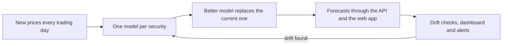

# Financial forecasting service

[![CI][ci-badge]][ci]

This service forecasts the next trading day's price change of several securities and
offers the forecasts through an API and a web app.

**Not investment advice.** Short-term prices move close to randomly. Every model is
compared with two simple baselines, "tomorrow's price equals today's" and the historical
mean change, and beating them is not expected.



It is for anyone who wants to see a complete MLOps chain run on one machine, from data
source to forecasts and monitoring, and to judge a forecasting model honestly against
simple baselines. Everything runs locally on your own machine with your own free data
key; no part of it runs in the cloud, and the stored price data never leaves your
machine. The documents call whoever runs a copy of the system a member; every team
member runs their own copy.

It is a group project of the DataScientest MLOps bootcamp (sep26 cohort), built by a
team of three; see [docs/team.md].

Built with Python, FastAPI, scikit-learn, PostgreSQL, MLflow, DVC, Airflow, Evidently,
Prometheus, Grafana, Streamlit, SeaweedFS and Docker Compose; what each does and why it
was chosen is in [ARCHITECTURE.md].

[ARCHITECTURE.md]: ARCHITECTURE.md#stack
[ci]: https://github.com/DataScientest-Studio/sep26_bmlops_int_financial_pred/actions/workflows/ci.yaml
[ci-badge]: https://github.com/DataScientest-Studio/sep26_bmlops_int_financial_pred/actions/workflows/ci.yaml/badge.svg
[docs/team.md]: docs/team.md

## What it does

Behind the forecasts runs an MLOps chain that needs no manual step once you switch its
Airflow pipelines on ([the whole chain][chain]):

-   It loads the new prices of every security from the data source each trading day.
-   It trains one model per security when needed: when the security has no model yet,
    when its data has drifted or when its model has grown old, and every security when
    the forecasts drift.
-   It records every training run in MLflow and lets a new model replace the current one
    only if the new one forecasts better.
-   It checks whether the data or the forecasts drift and starts training when they do.
-   It shows its health on a Grafana dashboard and raises alerts when too many API
    requests end in a server error, the data is not fresh or a daily update was missed.

Without the pipelines, you load the new prices by hand with `make update` once a day.

[chain]: ARCHITECTURE.md#how-the-chain-fits-together

## Quick start

You need Docker Engine 28.0 or later with Compose, `make` and `git`, and a free API key
from [EODHD], the market-data provider. From a fresh clone:

```bash
cp .env.example .env     # then put your EODHD key into .env as EODHD_API_KEY
make update              # starts the database and loads the price history from EODHD
make train               # trains a model for each security
make webapp              # starts the web app and the API it calls
```

Then open the web app at `http://localhost:<WEBAPP_PORT>`. `WEBAPP_PORT` is set in the
`.env` you copied from `.env.example`. The API is at `http://localhost:<API_PORT>`, with
`API_PORT` set there too, and its documentation is at `/docs`.

To let the system run by itself, start Airflow and the monitoring with `make airflow`
and `make monitoring`, and switch the pipelines on as [DEPLOYMENT.md][pipelines]
describes. That section also says when you may run the commands by hand instead.
[DEPLOYMENT.md] covers everything else: every setting, updating, rolling back and
checking that it runs.

[DEPLOYMENT.md]: DEPLOYMENT.md
[EODHD]: https://eodhd.com
[pipelines]: DEPLOYMENT.md#pipelines

## Documents

| Document | Content |
|---|---|
| [ARCHITECTURE.md](ARCHITECTURE.md) | How it is built and why: stack, design, alternatives, constraints |
| [DEPLOYMENT.md](DEPLOYMENT.md) | Installing, configuring, updating, rolling back and checking it |
| [SECURITY.md](SECURITY.md) | What it holds, who can reach it and how, and how to report a problem |
| [CONTRIBUTING.md](CONTRIBUTING.md) | Development setup, tests, code style and how a change is made |
| [CODE_OF_CONDUCT.md](CODE_OF_CONDUCT.md) | Expected conduct and how to report a breach |
| [docs/plan.md](docs/plan.md) | Decisions, decision proposals, roadmap, phase plans, open questions |
| [docs/requirements.md](docs/requirements.md) | Objectives, key metrics and requirements |
| [docs/team.md](docs/team.md) | Team setup as first proposed: areas, meetings, communication, work tracking |
| [docs/dependencies.md](docs/dependencies.md) | Every Python package and what it does |
| [docs/decisions/](docs/decisions/) | One file per team decision: options and reasons |
