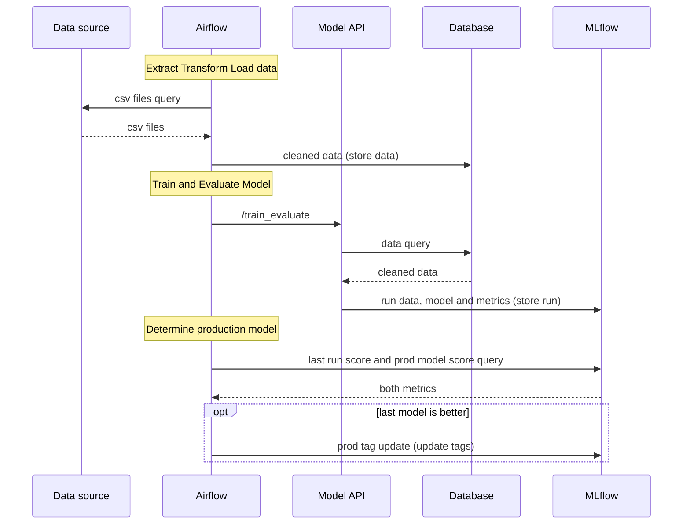
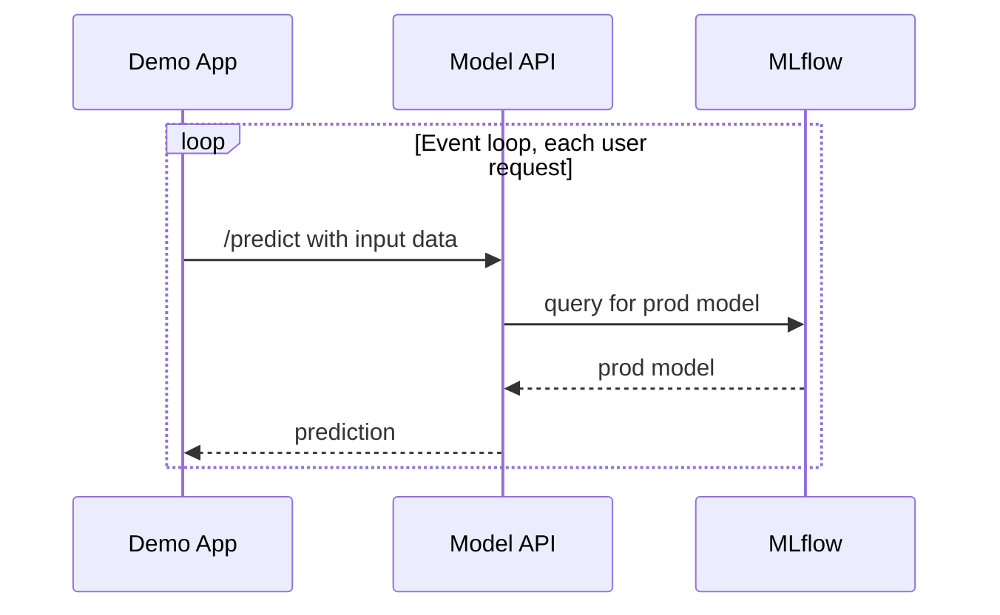

# Reference architecture

Charts are examples from the course (training chart shows data.gouv.fr CSVs as source — copied from another subject; replace with a market-data source). Note swapped file names (see `README.md`).

The diagrams below redraw the charts as sequence diagrams: one column per service, time runs top to bottom, solid arrows are requests, dashed arrows are answers.

## Training pipeline (chart n°1, `course-material/predict_pipeline.png`) — batch, scheduled (Airflow / Jenkins / cron)
Services (swimlanes): data source · Airflow · Model API · Database (PostgreSQL logo) · MLflow.
1. Airflow **ETL**: query source → CSV/data → clean → store in Database.
2. Airflow **Train & Evaluate**: calls Model API `/train_evaluate`; API queries cleaned data from DB, trains, logs run (model + metrics) to MLflow.
3. Airflow **Determine production model**: query MLflow for last-run score and prod-model score; if last model better → update prod tag in MLflow.

## Prediction pipeline (chart n°2, `course-material/training_pipeline.png`) — real-time
Services: Demo App (Streamlit) · Model API (FastAPI) · MLflow.
- App event loop sends input → API `/predict` → API queries MLflow for the prod model → returns prediction to app.
- Phase 3 extension (forum): API also stores prediction + features in DB; drift DAG reads them.

## Component map (kick-off deck)
- Data services: ingestion, preprocessing, feature engineering
- ML services: training, inference
- Orchestration: workflows, scheduler, messaging
- Infrastructure: centralised logging, monitoring (infra + ML), configuration

## Principles (kick-off deck)
- Docker containers: isolation, reproducibility, portability, dependency management
- Microservices: separated responsibilities, independent scaling, maintainability, resilience
- Container orchestration: docker-compose for dev, Kubernetes for prod, resources, autoscaling
- Workflow automation: Airflow/Prefect, automated data + ML pipelines, task dependencies, pipeline monitoring

## Tool options shown in the deck's overview diagram
| Area | Options |
|---|---|
| Env setup | Python, conda, Poetry, pipenv, Docker, GitHub/GitLab |
| Data mgmt (ETL) | ingestion → versioning (DVC, lakeFS) → feature eng. → storage (S3, MinIO, PostgreSQL) |
| Training/tracking | MLflow, W&B, neptune.ai (tracking + registry) |
| Deployment | FastAPI, Flask, BentoML |
| Monitoring | Evidently, Prometheus, Grafana (production data + model monitoring → loops back to ingestion) |
| Automation | Airflow, Flyte, Prefect, Kubeflow |

## Stack fixed by the forum post (not optional)
MLflow (tracking + registry), Docker + docker-compose, DVC without Git, Airflow (drift DAGs; recommended for scheduling), Evidently, Prometheus + Grafana, Streamlit, a SQL or NoSQL DB. Optional: GitHub Actions, Docker Hub, Basic/OAuth2, Kubernetes.
